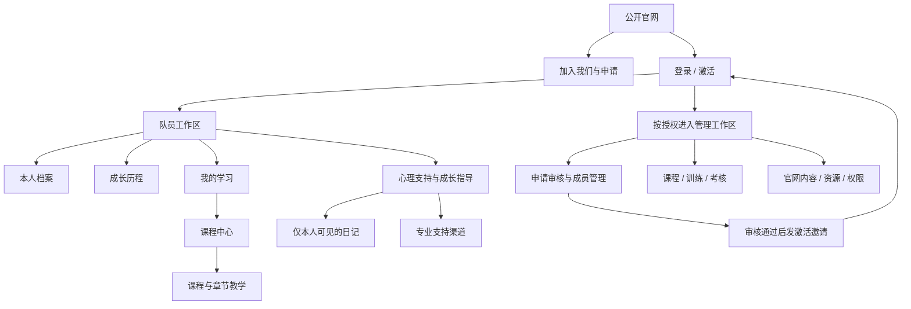

# 教官大队数字平台｜第二阶段功能架构

设计基准：2026-10-19。状态：待评审；未选首页、未开发前端、未连接认证或数据库。本文的路由、权限及流程是设计约定，不代表已实现。六张关键页面是同一套界面的不同页面，不是六个互斥方案。

## 1. 与第一阶段的关系

三张首页原稿原样保存在 `originals/`：home-01 队列·序章、home-02 守望·画册、home-03 青春·档案。保留摄影、主标题、栏目及首页叙事节奏；不把课程、成绩或管理表格塞入首页。

新增通用入口：未登录显示「队员登录」，已登录显示「个人中心」。移动端放进菜单并保留明显入口。原型阶段统一标记「演示模式」；正式系统才根据真实会话切换。方案 1 的入口位置仅用于六张关键页面中的首页示意，不构成选型。

三个方案都接入同一套路由、账号、数据接口和内页规范。选定首页后再统一摄影裁切、字形、标题比例及转场；不为三个视觉方案开发三套账号系统。

## 2. 系统地图

心理支持的公开科普可在内容审核后提供给游客；内部资源和私人记录仍需要对应授权。求助默认直接前往经核验的校内或专业渠道，不自动建立管理员可读的求助工单。

| 区域 | 页面与建议路由 | 访问边界 |
|---|---|---|
| 公开官网 | `/`、`/about`、`/training`、`/members`、`/honors`、`/memories` | 只读取审核发布的内容；公开队员故事是独立发布副本 |
| 加入与申请 | `/join`、`/apply`、`/application-status` | 无账号可提交；查询凭受保护的验证凭证，不通过递增编号查询他人申请 |
| 账号 | `/login`、`/activate`、`/recover` | 激活资格来自审核邀请；注册本身不授予正式队员权限 |
| 队员首页 | `/me` | 今日学习、本人训练摘要、公告、继续学习；不展示他人成绩 |
| 本人档案 | `/me/profile`、`/me/profile/edit` | 本人可编辑头像、昵称、简介；届别、职务等组织字段只读 |
| 成长历程 | `/me/growth`、`/me/reflections` | 本人训练、考核、里程碑与成长总结；无综合能力分 |
| 学习区域 | `/me/learning`、`/learn`、`/learn/courses/:courseId/lessons/:lessonId` | 正式成员资格、选课或授权、课程发布状态均需检查 |
| 心理支持 | `/support`、`/support/resources/:id`、`/me/journal` | 公开资源依发布范围；私人记录独立服务与权限 |
| 管理工作区 | `/manage` 及下述模块 | 服务端根据具体操作与数据范围授权；有菜单不等于有权限 |

全站返回官网的入口保持可见。登录前往受保护页时保留站内返回地址；失效会话重新登录后回原页面。返回地址只接受本站允许路由，避免任意外链跳转。停用成员保留已授权的个人资料访问范围待组织确认，不默认保留内部学习权限。

## 3. 角色与数据分级

权限计算：角色授权 ∩ 课程/队伍/成员范围 ∩ 字段权限 ∩ 记录状态。不同工作职责可组合，但禁止通过编辑个人资料、浏览器存储或申请字段给自己升级权限。

| 数据 / 操作 | 游客 | 正式队员 | 教学负责人 | 系统管理员 |
|---|---|---|---|---|
| 已发布官网内容 | 读取 | 读取 | 读取 | 依内容权限编辑、审核、发布 |
| 私人基本档案 | 无 | 本人读取、编辑允许字段 | 仅授权教学范围的必要姓名/分队字段 | 按成员管理权限维护组织字段与必要联系信息 |
| 他人私人档案 | 无 | 无 | 不提供完整私人档案 | 仅按职责授权，不默认导出全部资料 |
| 课程和教材 | 仅公开资源 | 读取获授权已发布课程 | 编辑负责课程；发布另需审核权限 | 内容授权范围内管理；不自动获得专业审核资格 |
| 学习进度 | 无 | 本人读写完成记录 | 负责课程的必要进度 | 默认不看个人明细；另授教学权限后按范围访问 |
| 出勤 / 技能成绩 | 无 | 本人只读、提交纠错 | 授权项目/队伍内登记和更正 | 只有获得训练数据权限后才能操作 |
| 申请材料 | 本人验证后查询状态 | 不自动获得他人申请权限 | 仅有招募审核授权时可审 | 仅获授权的申请审核人可审 |
| 成长总结 | 无 | 本人维护；可明确分享指定内容 | 仅读取明确分享且属于授权范围的条目 | 不默认读取私人正文 |
| 心理日记 / 情绪 / 求助内容 | 无 | 仅本人 | 无 | 无业务读取/搜索/导出权限 |
| 支持渠道配置 | 读取已发布渠道 | 同左 | 获内容授权可建议 | 获渠道管理授权可维护，不读取求助正文 |
| 账号角色与授权 | 无 | 查看本人状态 | 无，除非另授账户管理职责 | 受控授权、撤权与审计，禁止授予自己更高权限 |

公开人物专题不得直接读取 MemberProfiles 私人表；由本人同意、编辑审核后发布独立内容，可撤回。训练记录不因网站公开人物故事而公开。

## 4. 四条核心路径与状态

### 加入大队

官网 → 加入说明 → 表单草稿 → 校验必要字段和材料用途 → 提交确认 → 待审核 → 补充材料 / 通过 / 未通过 / 撤回 → 通过后一次性有时效邀请 → 验证受邀身份 → 设置认证凭据 → 激活成员资格 → 个人中心。

提交申请与账号激活分别建模。审核通过不等于浏览器获得队员权限；邀请使用、身份绑定和成员创建须由服务端原子处理、可安全重试。重复申请返回已接收状态。未通过只向本人提供适当反馈。报名条件、期限及联系方式待组织补充；当前设计不收集真实申请。

### 学习课程

登录 → 我的学习 → 已加入的队列课程 → 继续上次章节 → 播放审核后的教材 → 阅读图文与注意事项 → 按章节规则完成 → 服务端确认记录 → 更新章节列表和课程进度 → 下一章 / 课程考核待安排。

完成学习不等于技能合格。视频观看位置、章节完成、技能考核是三类不同记录。示例课程 20 章，已完成 13 章为 65%；当前第 14 章完成后为 14/20=70%。模拟按钮不得称为真实视频验证。

### 查看成长

登录 → 本人档案 → 成长历程 → 日期范围 → 训练概览 → 单项指标及考核标准版本 → 原始记录 → 里程碑 → 写成长总结。允许无数据、缺考、请假、标准变更、不适用状态，不将其画成零分。

### 登记考核

教学负责人登录 → 授权训练项目 → 项目与标准版本 → 参与队员 → 批量录入草稿 → 字段/单位/范围校验 → 预览确认 → 提交登记 → 成员页面重新获取已发布数据。草稿、未复核与已发布有明显区分；原始成绩更正保留旧值、理由与操作者。

未来后端使用事务、幂等请求与记录版本防止重复登记、覆盖冲突。原型使用同一浏览器演示数据仓库串联管理和成员视角，明确不支持真实多用户或跨设备同步。

## 5. 管理后台信息架构与界面

| 导航 | 页面内容 | 核心动作与边界 |
|---|---|---|
| 工作台 | 待处理申请、待审课程、待发布考核 | 只计入当前授权范围，不放心理数据 |
| 招募申请 | 待审核 / 补充材料 / 已处理 | 详情侧栏、审核理由、邀请状态、过期重发 |
| 队员与组织 | 届别、分队、队员列表、成员状态 | 必要字段、组织调整历史、停用流程 |
| 教学内容 | 五类课程、章节、审核队列 | 草稿→专业审核→发布→归档；未经审核不可发布 |
| 训练与考核 | 训练场次、出勤、项目标准、成绩 | 先选项目再选人；表格式录入；提交前预览 |
| 荣誉与活动 | 荣誉凭据、活动、里程碑 | 关联真实材料；个人荣誉公开须授权 |
| 网站内容 | 简介、纪实、人物专题、记忆、通知 | 发布范围、排期、撤回及版本 |
| 媒体资料 | 图片、视频、字幕、教材文件 | 权属/肖像授权、可见范围、审核、替代文本 |
| 账号与权限 | 账号状态、角色、范围授权、审计 | 高风险操作再验证；撤权生效；无私人日记菜单 |
| 支持资源配置 | 知识文章、资源、真实渠道及核验日期 | 仅配置发布资源和联系入口 |

后台桌面采用 224px 导航、64px 顶栏、筛选工具条、数据表、详情侧栏、提交预览。训练登记页列为「队员 / 状态 / 原始结果 / 单位 / 标准版本 / 备注」；不允许一格内混填不同单位。无权限隐藏入口并由服务端拒绝直接请求。

移动端优先查阅、审批和单人录入；批量成绩表改为逐人表单与完成计数，提供提交预览，不把宽表硬挤成小字。后台线框与以上信息架构先供评审，不包含额外的高保真后台图或已实现服务。

## 6. 本阶段交付与下一阶段

本阶段：功能架构、六张独立高保真桌面稿、页面交互规则、权限模型和后端方案预研。未进行身份认证、真实存储、提交申请、发送邀请、视频教学或任何后台部署。

确认首页与内页方向后：先做同一浏览器可持续的演示交互和移动端，再用确认过的流程定数据库、认证与后台实现顺序。后端方案此时不锁定。
